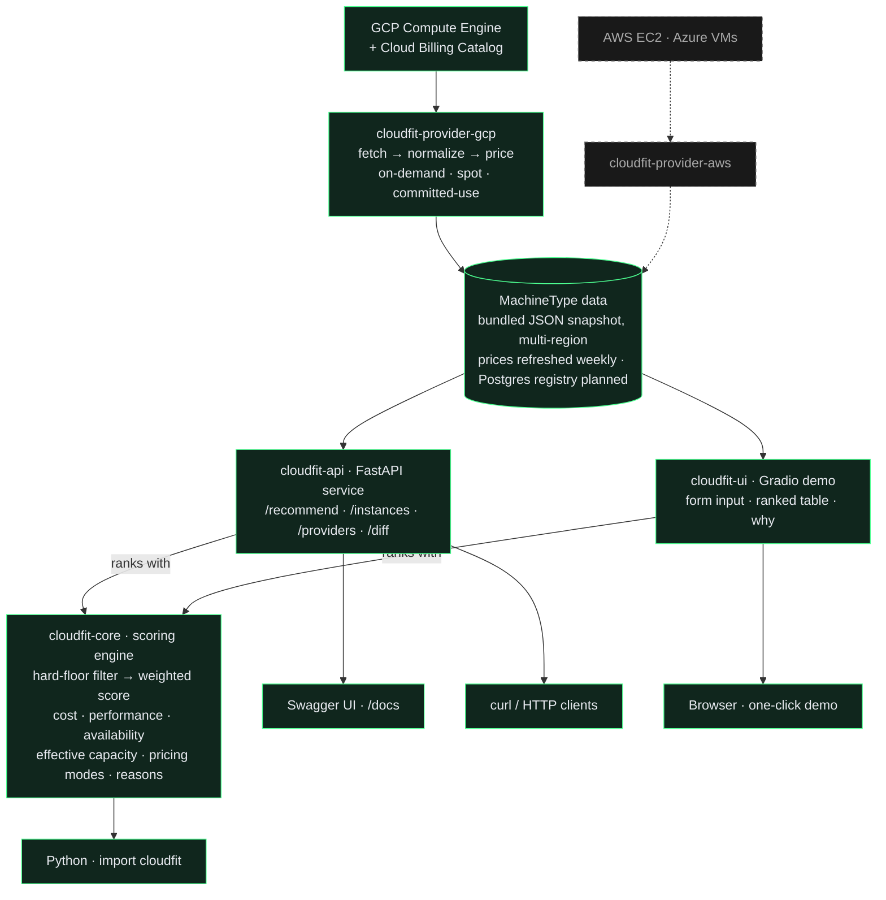

# cloudfit-io

**Cloud-agnostic machine type recommender for computational workloads.**

> Like a load balancer for cloud instances: it recommends the best machine type for your workload, explains why, and stays current as providers reprice, deprecate, and release machine types. GCP is live today; AWS is next.

Built with bioinformatics and batch workflow orchestration as the primary use case, but designed to be domain-agnostic.

**New here?** Try the [one-click demo](https://chaitanyakasaraneni-cloudfit-ui.hf.space), browse the [project site](https://cloudfit-io.github.io), or read the launch post: [Why I built cloudfit](https://ckasaraneni.com/blog/why-i-built-cloudfit) for the gap in existing free tooling (Compute Optimizer, Recommender, Advisor) and what cloudfit does about it.

---

## Libraries

| Package | Description | Status |
|---|---|---|
| [`cloudfit-core`](https://github.com/cloudfit-io/cloudfit-core) | Scoring engine · workload profiles · hard floors · effective capacity · spot and committed-use pricing · GPU throughput · explainable picks · disk sizing |  |
| [`cloudfit-provider-gcp`](https://github.com/cloudfit-io/cloudfit-provider-gcp) | GCP Compute Engine fetcher: machine types, lifecycle status, and on-demand, spot, and 1-year committed-use prices (multi-region). Refreshes the bundled snapshots weekly. |  |
| [`cloudfit-provider-aws`](https://github.com/cloudfit-io/cloudfit-provider-aws) | AWS EC2 instance fetcher | planning phase |
| [`cloudfit-api`](https://github.com/cloudfit-io/cloudfit-api) | REST API. `/recommend` · `/instances` · `/providers` · `/diff`, with a pricing mode and a reason for every pick. Multi-region snapshot bundled. Service, deployed as a container, not a PyPI package. |  [live demo ↗](https://chaitanyakasaraneni-cloudfit-api.hf.space/docs) |
| [`cloudfit-ui`](https://github.com/cloudfit-io/cloudfit-ui) | One-click Gradio demo. Workload profile in, ranked instances out, with a pricing mode selector and a reason for each pick. |  [live demo ↗](https://chaitanyakasaraneni-cloudfit-ui.hf.space) |

Release notes for every version are on each repo's **Releases** page, published automatically from its `CHANGELOG.md`.

## Features

- **Hard floors with reasons.** Region, vCPU, RAM, GPU presence and VRAM, and lifecycle status are checked first; anything that cannot run your workload is disqualified with a plain-language reason.
- **Effective capacity.** Each of 19 GCP machine families carries a documented `perf_factor` (n2 = 1.0), so vCPU fit and cost per unit of work reflect how fast the family really is.
- **Spot and committed-use pricing.** Score on `on_demand`, `spot`, or `cud_1yr` prices; burst workloads default to spot, and a missing price falls back to on-demand rather than looking free.
- **GPU-aware.** VRAM is a hard floor and the GPU archetype scores accelerator throughput, so an A100 outranks a T4 at equal VRAM.
- **Explainable picks.** Every result carries `contributions` (what cost, perf, and availability added to the score) and a one-line `reason`.
- **Headroom.** Ask for spare capacity above what you declare, as a hard requirement or a soft preference.
- **Archetypes, modes, and weights.** Five archetypes, four `optimize_for` modes, custom weights, and YAML workload profiles.
- **Disk sizing.** `compute_disk_tb` estimates scratch disk from sequencer, flowcell, and lane count.
- **Current catalog.** Deprecated machine types score lower and tombstoned ones are disqualified; prices are refreshed weekly from the GCP billing catalog via reviewed pull requests.

## Architecture



Solid green = shipped · dashed grey = planned.

## Quick example

```python
from cloudfit import WorkloadProfile, MachineType, rank

profile = WorkloadProfile(
    vcpu=60,
    ram_gb=224,
    archetype="io",                # io | cpu | mem | gpu | burst
    optimize_for="balanced",       # cost | performance | availability | balanced
    region="us-central1",          # optional region hard floor
    pricing_mode="on_demand",      # on_demand | spot | cud_1yr (default: spot for burst)
)

# Candidate instances come from a cloudfit-provider-* package
# (e.g. `pip install cloudfit-provider-gcp`), or supply your own list:
candidates = [
    MachineType(id="t2d-standard-60",      provider="gcp", vcpu=60, ram_gb=240, price_hr=2.31, region="us-central1"),
    MachineType(id="c3d-standard-60-lssd", provider="gcp", vcpu=60, ram_gb=240, price_hr=3.39, region="us-central1"),
]

best = rank(profile, candidates)[0]
print(f"{best.instance.provider} {best.instance.id}  ${best.instance.price_hr}/hr  score: {best.score}")
# → gcp t2d-standard-60  $2.31/hr  score: 0.9971
print(best.reason)
# → Led by performance fit.
```

## Related projects

- [`samplesheet-parser`](https://github.com/chaitanyakasaraneni/samplesheet-parser): Format-agnostic Illumina SampleSheet parser (BCLConvert V2 + IEM V1)
- [`clinops`](https://github.com/chaitanyakasaraneni/clinops): Clinical ML data quality library

---

**Author:** [Chaitanya Krishna Kasaraneni](https://ckasaraneni.com)
&nbsp;·&nbsp; [Google Scholar](https://scholar.google.com/citations?user=Y2S8D2UAAAAJ)
&nbsp;·&nbsp; [ORCID 0000-0001-5792-1095](https://orcid.org/0000-0001-5792-1095)
